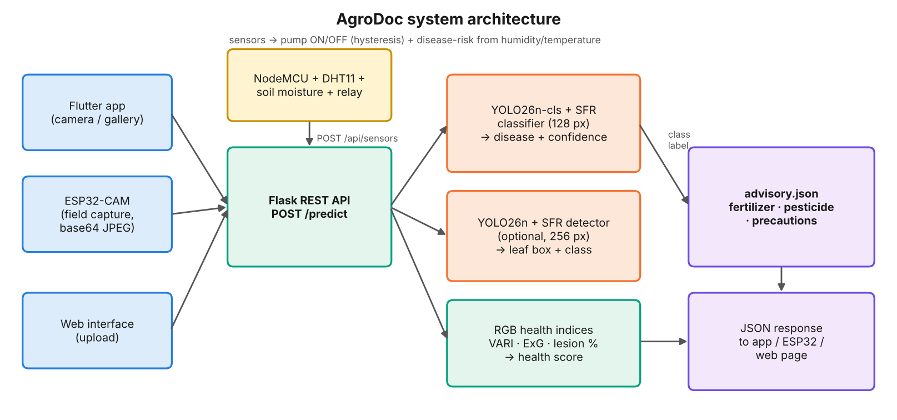
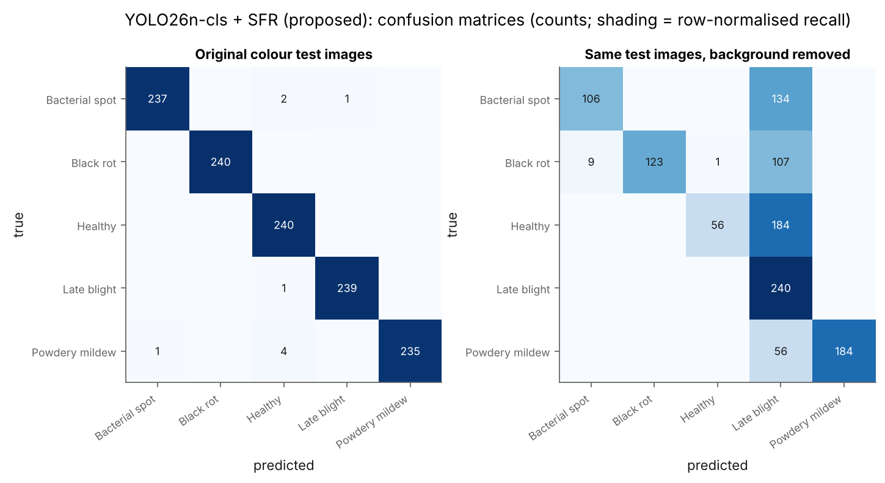
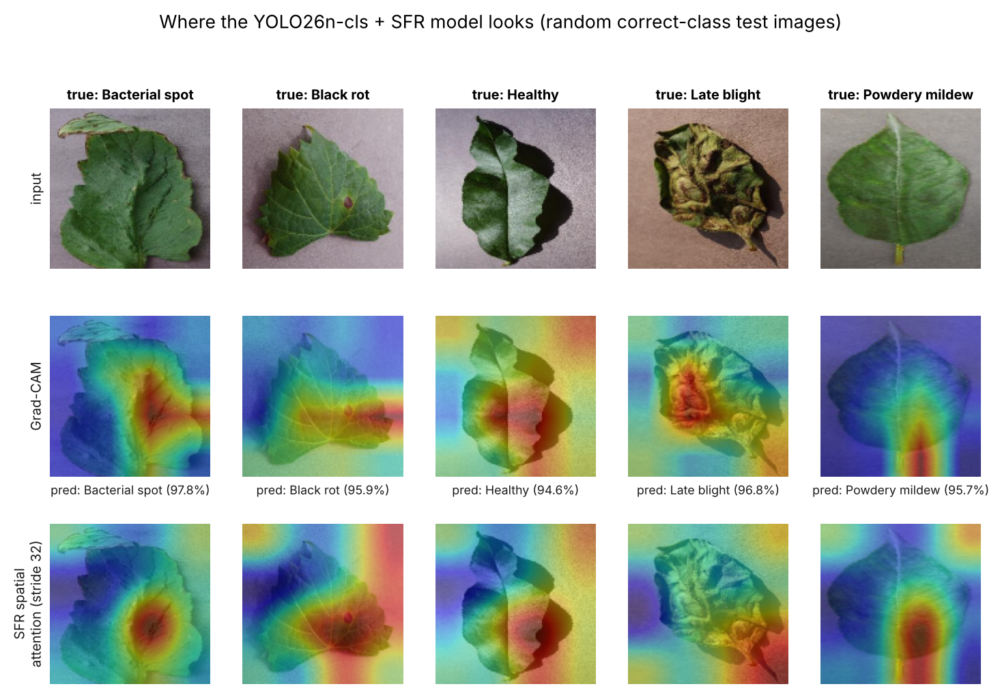
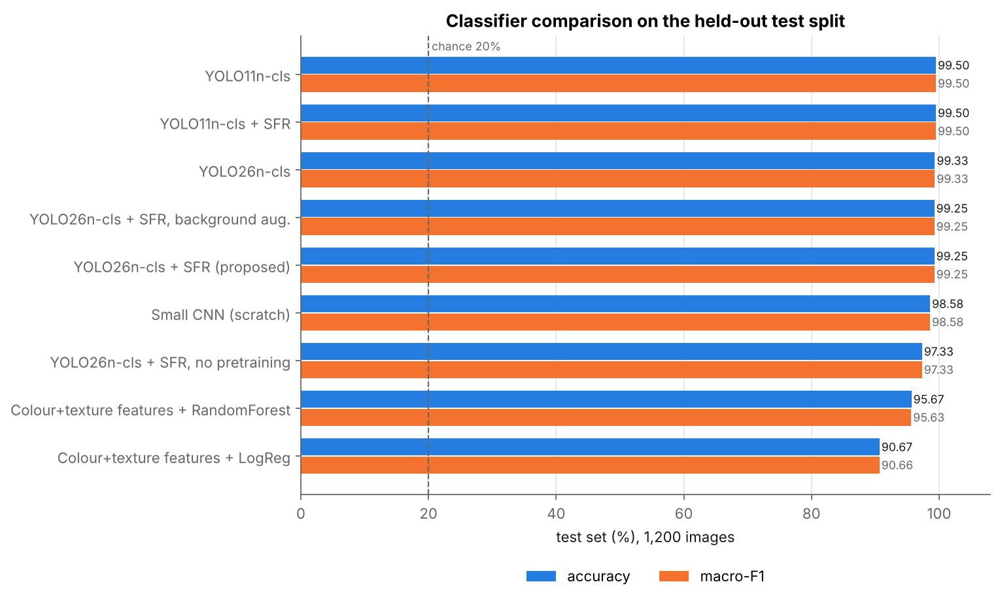
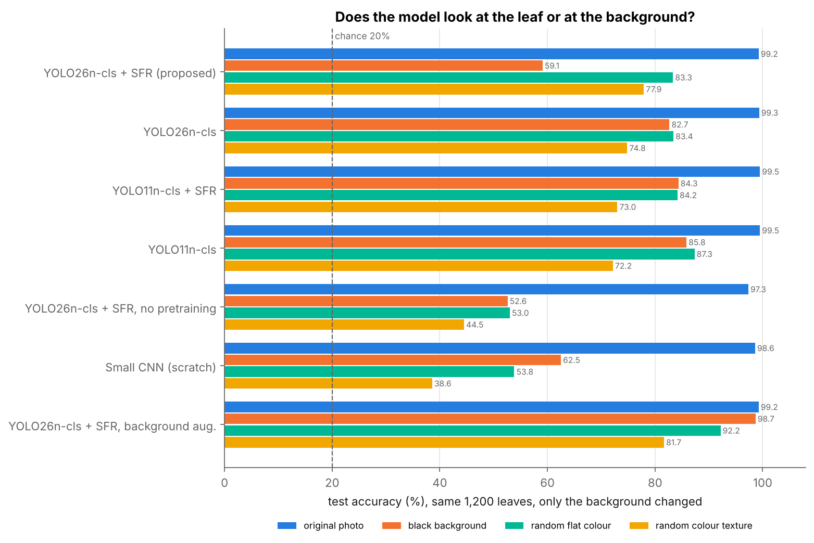
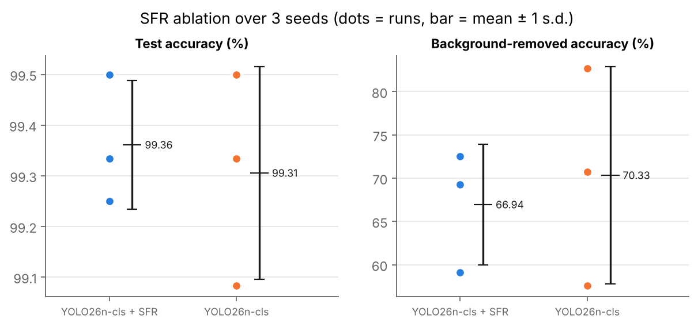
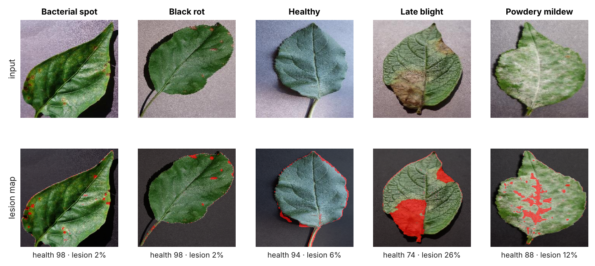
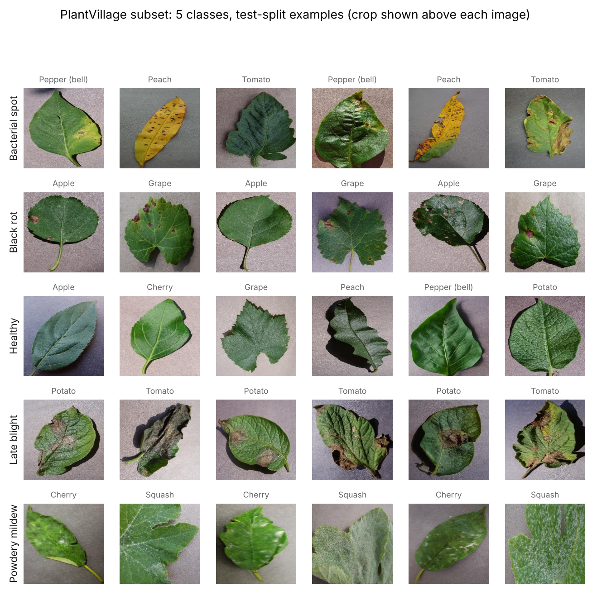
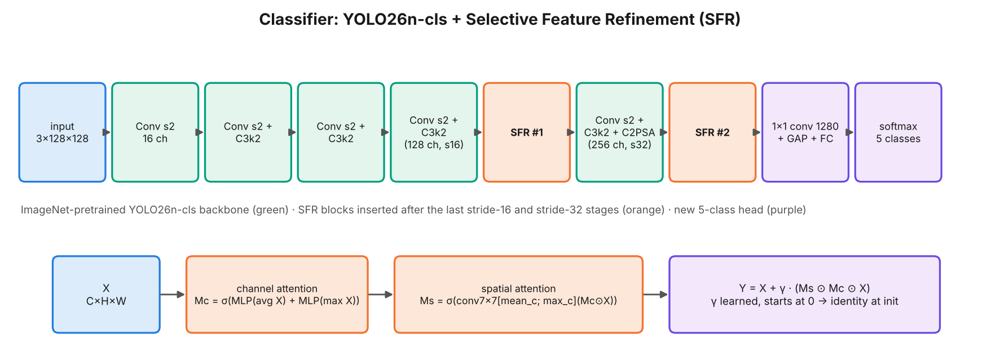
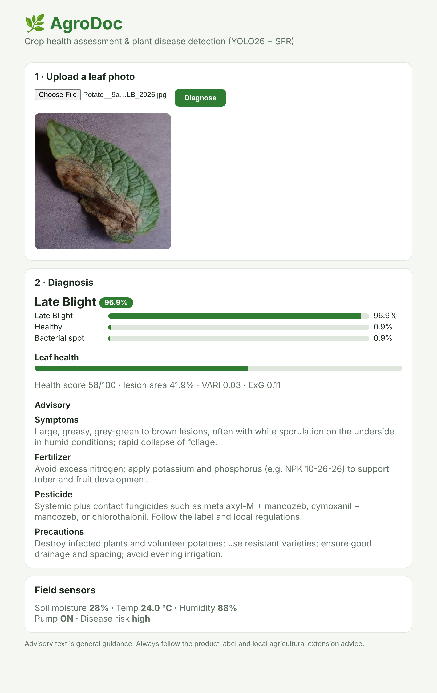

# 🌿 Crop Health Assessment and Disease Detection via Attention-Mechanism and Smart Sensing in Precision Farming

An end-to-end deep-learning + IoT system. It recognises leaf diseases from a photo, scores leaf health,
gives fertilizer/pesticide/precaution advice, and controls irrigation from field sensors. Users reach it
through a web page, a Flutter app or an ESP32-CAM.

**Model:** Ultralytics **YOLO26** (newest generation; upgraded from the original YOLOv5) with
**Selective Feature Refinement (SFR)** attention, compared against YOLO11, YOLOv5, a CNN from scratch and
classical colour/texture baselines.
**Data:** **real PlantVillage images** in the original project's five classes. Full write-up in **[REPORT.md](REPORT.md)**.
The long, beginner-friendly explanation is in **[docs/Project_Guide.pdf](docs/Project_Guide.pdf)**.



> This repository was rebuilt from scratch after the original files were lost. The README, the screenshots in
> `screenshots/` and the original training log are all that survived. Everything else (data pipeline, models,
> training, evaluation, app, firmware, docs) was re-implemented and re-run. The original project's numbers are
> kept separately in [Results reported in the original project](#results-reported-in-the-original-project).

---

## Results (reproduced, real data)

Held-out **test split of 1,200 real PlantVillage images** (240 per class, never seen in training). Chance = 20%.

| Model | Accuracy | Macro-F1 | Macro AUC | Acc. with background removed |
|---|---|---|---|---|
| **YOLO26n-cls + SFR (proposed)** | **99.25%** | **0.9925** | 0.9996 | 59.1% |
| YOLO26n-cls (no SFR) | 99.33% | 0.9933 | 1.0000 | 82.7% |
| YOLO11n-cls + SFR | 99.50% | 0.9950 | 1.0000 | 84.3% |
| YOLO11n-cls | 99.50% | 0.9950 | 1.0000 | 85.8% |
| YOLO26n-cls + SFR, no ImageNet pretraining | 97.33% | 0.9733 | 0.9980 | 52.6% |
| Small CNN from scratch | 98.58% | 0.9858 | 0.9996 | 62.5% |
| **YOLO26n-cls + SFR + background augmentation (deployed)** | **99.25%** | 0.9925 | 0.9998 | **98.7%** |
| Colour + texture features + random forest | 95.67% | 0.9563 | 0.9966 | - |
| Colour + texture features + logistic regression | 90.67% | 0.9066 | 0.9881 | - |
| Majority class | 20.00% | 0.0667 | - | - |

<!-- DET_BEGIN -->
**Detection** (one automatic leaf box per image; stratified 35% of the training split, 256 px, 15 epochs; full 1,200-image test split):

| Detector | Params | P | R | mAP@0.5 | mAP@0.5:0.95 | Image-level acc. | Train time |
|---|---|---|---|---|---|---|---|
| **YOLO26n + SFR (proposed)** | 2.56 M | 0.985 | 0.981 | 0.993 | 0.958 | 98.58% | 22 min |

*YOLO26n, YOLO11n and YOLOv5n detectors (same settings) are still training; their rows will be added here.*
<!-- DET_END -->

**SFR ablation over three seeds:** YOLO26n-cls + SFR **99.36 ± 0.13%**, YOLO26n-cls **99.31 ± 0.21%**. The
difference is under one test image, so SFR gives **no measurable gain** on PlantVillage.

**Background robustness:** the same 1,200 test leaves, with only the background replaced.

| Model | Original | Black | Random flat colour (unseen) | Random texture (unseen) |
|---|---|---|---|---|
| YOLO26n-cls + SFR | 99.25% | 59.08% | 83.33% | 77.92% |
| YOLO26n-cls | 99.33% | 82.67% | 83.42% | 74.83% |
| YOLO11n-cls | 99.50% | 85.83% | 87.33% | 72.17% |
| Small CNN from scratch | 98.58% | 62.50% | 53.83% | 38.58% |
| **YOLO26n-cls + SFR + background aug.** | **99.25%** | **98.67%** | **92.17%** | **81.67%** |

**Honest reading of these numbers**
* Every deep model is above 97%, and a classical random forest reaches 95.7%. PlantVillage, with single leaves on
  a lab background, is an easy benchmark.
* With the background changed, accuracy falls to 39-88%. The models partly rely on the lab background, lighting
  and crop identity.
* Training on background-removed images 50% of the time fixes much of this at no cost on normal images.
  That model is the app's default (`results/models/yolo26_cls_sfr_bgaug.pt`).
* **Validate on real field photos before trusting it on a farm.**

| | |
|---|---|
|  |  |
|  |  |
|  |  |

## Results reported in the original project

From the surviving screenshots (`screenshots/trainresults.jpg`, `screenshots/heat_map.jpg`). Model: YOLOv5
(7.02 M params, 15.8 GFLOPs) + SFR, 100 epochs at 640 px, 47.4 h on CPU, Roboflow export of PlantVillage
images with hand-drawn boxes, **430 validation images / 539 boxes**:

| Class | P | R | mAP@0.5 | mAP@0.5:0.95 |
|---|---|---|---|---|
| all | 0.743 | 0.723 | 0.743 | 0.428 |
| Bacterial_spot | 0.550 | 0.432 | 0.486 | 0.215 |
| Black_rot | 0.586 | 0.647 | 0.652 | 0.232 |
| Healthy | 0.972 | 0.959 | 0.977 | 0.697 |
| Late_Blight | 0.686 | 0.697 | 0.696 | 0.347 |
| Powder_Mildew | 0.921 | 0.880 | 0.902 | 0.648 |

These are **not directly comparable** with the rebuild: a different split, hand-drawn multi-box labels instead of
automatic single boxes, and a different architecture and resolution. The repository also contains a 93-99%
per-class bar chart, a "High Accuracy Representation" confusion matrix and smooth ROC curves (AUC 0.95-0.98).
These do not match the logged run, so they are treated as illustrative, not as results (REPORT.md §9).

---

## Features

* Leaf disease recognition: **YOLO26n-cls + SFR** classifier, plus a **YOLO26n + SFR** detector for leaf localisation
* Grad-CAM and SFR attention maps for explainability
* RGB crop-health indices (VARI, ExG, GLI, lesion fraction, 0-100 health score)
* Advisory for fertilizer, pesticide and precautions (`app/advisory.json`)
* Flask REST API + responsive web interface (light/dark)
* Flutter mobile app (camera/gallery → diagnosis)
* ESP32-CAM field capture (base64 JPEG → `/predict`)
* NodeMCU + DHT11 + soil-moisture + relay: hysteresis irrigation and a humidity-based disease-risk flag

## Dataset

**PlantVillage** ([spMohanty/PlantVillage-Dataset](https://github.com/spMohanty/PlantVillage-Dataset), Hughes &
Salathé 2015). The original project's test filenames (`UMD_Powd.M`, `FAM_B.Rot`, `Rutg._Bact.S`, `GHLB2 Leaf`,
`RS_HL`…) are PlantVillage filenames, so the same source was used, and its 38 folders were merged into five classes:

| Class | PlantVillage source folders |
|---|---|
| Bacterial_spot | Pepper bell, Peach, Tomato bacterial spot |
| Black_rot | Apple, Grape black rot |
| Healthy | Apple, Cherry, Grape, Peach, Pepper bell, Potato, Tomato healthy |
| Late_Blight | Potato, Tomato late blight |
| Powder_Mildew | Cherry, Squash powdery mildew |

**1,600 images per class (8,000 total)**, sampled evenly across source crops with a fixed seed, plus the
background-removed version of each image. Split **70/15/15** (5,600 / 1,200 / 1,200), stratified by class × crop.
Raw data is not committed. `scripts/download_plantvillage.py` fetches exactly the same subset (~3 min, ~230 MB).



## Method

1. **Preprocessing**: verify images; leaf mask from the PlantVillage segmented image → automatic YOLO box;
   health indices; 128×128 arrays for the classifier, 256×256 originals for the detector.
2. **Augmentation**: flips, 90° rotations, affine (±20°, 0.85-1.15 scale, ±10% shift), brightness/contrast/colour jitter.
3. **Model**: ImageNet-pretrained YOLO26n-cls backbone. **SFR** blocks go after the last stride-16 and stride-32
   stages: channel attention `Mc = σ(MLP(avg X) + MLP(max X))`, spatial attention
   `Ms = σ(conv7×7[mean; max](Mc⊙X))`, output `Y = X + γ·(Ms⊙Mc⊙X)` with γ initialised to 0. Head: 1×1 conv →
   GAP → dropout → FC(5).
4. **Training**: label-smoothed cross-entropy, AdamW (lr 2e-3, wd 5e-4), warm-up + cosine, 15 epochs, best
   validation macro-F1 checkpoint. Detector: Ultralytics trainer with SFR on P3/P4/P5, 256 px, 15 epochs.
5. **Evaluation**: accuracy, per-class P/R/F1, confusion matrix, ROC/AUC, mAP@0.5 and @0.5:0.95, Grad-CAM, and a
   background-removed robustness test.



**CPU budget (documented):** no GPU was available. Classifiers use 128-px inputs (~25 s/epoch on 4 cores).
Detectors are trained on a class × crop stratified 35% subset of the training split (1,960 images) for 15
epochs at 256 px, and evaluated on the full test split. Ultralytics' own `fraction=` keeps the first N files in
sorted order and silently dropped whole crops in our first attempt (REPORT.md §8.5).

## Project structure

```
├── scripts/
│   ├── download_plantvillage.py   # resumable, balanced 5-class PlantVillage download (+ segmented images)
│   ├── preprocess.py              # masks, YOLO boxes, health indices, splits, 128-px arrays, YOLO dataset
│   ├── run_classification.sh      # all classifier experiments
│   ├── run_detection.sh           # all detector experiments
│   ├── run_extra.sh, run_seeds.sh # background-augmentation run, extra seeds for the SFR ablation
│   ├── make_figures.py            # result figures + results/summary.md
│   └── make_guide_figures.py      # architecture diagrams
├── src/
│   ├── config.py   sfr.py   models.py   data.py   health.py   gradcam.py   irrigation.py
│   ├── train_classifier.py        # classifier training / evaluation (also --data synthetic sanity check)
│   ├── train_detector.py          # YOLO26n / YOLO11n / YOLOv5n (± SFR) detector training / evaluation
│   ├── baseline_features.py       # colour + texture features → LogReg / RF baselines
│   ├── eval_backgrounds.py        # background-robustness test (black / random colour / texture)
│   └── predict.py                 # inference: disease + confidence + advisory + health (+ boxes, Grad-CAM)
├── app/                           # Flask API, web interface, advisory.json
├── mobile_app/                    # Flutter client (source)
├── firmware/                      # ESP32-CAM capture, NodeMCU sensors + pump (Arduino source)
├── tests/test_pipeline.py         # pytest (18 tests)
├── results/                       # metrics.json per model, summary.md, trained models (results/models/*.pt)
├── docs/                          # Project_Guide.pdf, its builder, figures
├── screenshots/                   # surviving screenshots of the original project
├── REPORT.md
└── requirements.txt
```

## Getting started

```bash
pip install -r requirements.txt
python scripts/download_plantvillage.py --out data/raw --per-class 1600
python scripts/preprocess.py
```

Train and evaluate (numbers and figures land in `results/` and `docs/figures/`):

```bash
python -m src.train_classifier --model yolo26_cls_sfr --epochs 15        # proposed classifier, ~7-10 min on CPU
python -m src.train_detector --arch yolo26n --sfr --epochs 15 --fraction 0.35
python -m src.baseline_features
python -m src.eval_backgrounds                                           # background-robustness test
bash scripts/run_classification.sh && bash scripts/run_detection.sh      # every experiment in REPORT.md
python scripts/make_figures.py
```

Quick pipeline check without downloading anything (**synthetic images, sanity check only**):

```bash
python -m src.train_classifier --data synthetic --epochs 3
```

Inference and the app (trained checkpoints are included in `results/models/`; pretrained YOLO weights are fetched
from the Ultralytics GitHub releases on first use):

```bash
python -m src.predict leaf.jpg --gradcam cam.png
python app/app.py          # http://localhost:5000  (DETECTOR=results/models/det_yolo26n_sfr.pt to add boxes)
pytest -q
```

### Sample API response

`POST /predict` with a multipart field `image` or JSON `{"image": "<base64>"}` (ESP32-CAM):

```json
{
  "disease": "Late Blight", "class": "Late_Blight", "confidence": 0.949,
  "top3": [{"class": "Late_Blight", "prob": 0.949}, {"class": "Bacterial_spot", "prob": 0.014}, {"class": "Powder_Mildew", "prob": 0.014}],
  "fertilizer": "Avoid excess nitrogen; apply potassium and phosphorus (e.g. NPK 10-26-26) ...",
  "pesticide": "Systemic plus contact fungicides such as metalaxyl-M + mancozeb ...",
  "precautions": "Destroy infected plants and volunteer potatoes; use resistant varieties ...",
  "health": {"health_score": 58.1, "lesion_fraction": 0.419, "vari": 0.03, "exg": 0.11},
  "low_confidence": false
}
```



## Tech stack

| Layer | Tech |
|---|---|
| ML model | YOLO26n-cls / YOLO26n + SFR (PyTorch, Ultralytics 8.4); baselines YOLO11n, YOLOv5n, CNN, scikit-learn |
| Backend API | Flask |
| Web interface | HTML / CSS / JavaScript (served by Flask) |
| Mobile app | Flutter (Material 3) |
| IoT | ESP32-CAM, NodeMCU (ESP8266), DHT11, capacitive soil-moisture sensor, relay + pump |
| Advisory DB | JSON |

## Limitations

* PlantVillage is a lab dataset; field accuracy will be lower (see the background-removed test).
* One random split; the SFR ablation uses three seeds. Detectors were trained on a 35% subset (CPU budget).
* Detection boxes are generated automatically from segmentation masks (one per image).
* The health score is a colour rule, not validated against expert severity ratings.
* The Flutter app and Arduino firmware are provided as source. They were not built or flashed in this rebuild
  (no SDK or hardware available). The Flask API and web interface were run and tested end to end.
* Advisory text is general guidance. Follow product labels and local agricultural extension advice.

## License

MIT (see `LICENSE`).
