# Crop Health Assessment and Disease Detection via Attention Mechanism and Smart Sensing in Precision Farming

**Technical report: rebuilt and re-run implementation**

> Every number in Sections 7-8 was produced by the code in this repository, run on real PlantVillage images in
> this rebuild. The original project's numbers (from its surviving screenshots) are kept separately in Section 9.
> The one synthetic-data run (Section 6.5) is a pipeline sanity check only and is labelled as such.

---

## Abstract

Leaf diseases cause large, avoidable crop losses, and smallholder farmers rarely have quick access to an expert.
This project builds an end-to-end system to fill that gap. A photo of a leaf, taken with a phone, a web page or an
ESP32-CAM, goes to a Flask API. The API returns one of five conditions (bacterial spot, black rot, late blight,
powdery mildew or healthy), a confidence, a 0-100 colour-based health score and fertilizer, pesticide and
precaution advice. A NodeMCU sensor node drives an irrigation pump with a hysteresis controller and flags humid,
disease-favouring weather.

The recognition model is an ImageNet-pretrained **YOLO26n-cls** (the newest Ultralytics generation; the original
project used YOLOv5) with two **Selective Feature Refinement (SFR)** blocks. SFR is a residual channel-plus-spatial
attention module that starts as an identity. A YOLO26n + SFR detector localises the leaf. We trained on 5,600 real
PlantVillage images (8,000 sampled, 1,600 per class, balanced across 16 source folders) and tested on 1,200 held-out
images.

* The proposed classifier reaches **99.25% accuracy (macro-F1 0.9925, macro AUC 0.9996)**. Chance is 20%, and a
  colour + texture random forest scores 95.67%.
* Three-seed runs show that SFR gives **no measurable gain** on this benchmark. All pretrained YOLO classifiers land
  within ±0.3 points of each other.
* A background-removal test exposes a shortcut. Accuracy falls to 53-86% when the lab background is blacked out,
  so the models partly rely on the background and lighting rather than the lesions. Training with
  background-removal augmentation keeps 99.25% on normal images and raises accuracy on unseen random
  backgrounds to 82-92% (§8.4). The deployed app uses this model.

We report these limits explicitly. The system should be validated on field photographs before it is used on a farm.

---

## 1. Problem statement

Farmers need a fast, cheap and understandable way to tell whether a plant is diseased, which disease it is and what
to do next. Expert diagnosis is slow and scarce, and visual guessing leads to wrong or excessive pesticide use. At
the same time, irrigation is often manual, and both over-watering and under-watering harm the crop and raise
disease pressure. The original project set out to combine (a) image-based disease recognition with an attention
mechanism, (b) a simple leaf-health score, (c) actionable advice and (d) sensor-driven irrigation in one system
reachable from a phone, a browser or a field camera.

## 2. Objectives

1. Identify the dataset used by the original project and rebuild the data pipeline on the **real** data.
2. Implement the attention model (SFR) on a modern YOLO backbone, and compare it fairly against the same backbone
   without SFR, YOLO11, YOLOv5, a CNN trained from scratch and classical feature baselines.
3. Evaluate on a held-out test split: accuracy, per-class precision/recall/F1, confusion matrix, ROC/AUC, detection
   mAP, Grad-CAM explanations and RGB health indices.
4. Test whether the model uses the leaf or the background (robustness check).
5. Deliver an inference script, a REST API, a web interface, a Flutter client and ESP32/NodeMCU firmware.
6. Report honestly, including what did not work.

## 3. Dataset

### 3.1 Identifying the source

The original README and screenshots name five classes (`Bacterial_spot`, `Black_rot`, `Healthy`, `Late_Blight`,
`Powder_Mildew`). The original test-image filenames contain PlantVillage photographer/lab tags: `UMD_Powd.M`
(University of Maryland, powdery mildew), `FAM_B.Rot` (black rot), `Rutg._Bact.S` (Rutgers, bacterial spot),
`GHLB2 Leaf` (greenhouse late blight) and `RS_HL` (healthy). The `.rf.` suffix shows the images were exported through
Roboflow. The source is therefore **PlantVillage** (Hughes & Salathé, 2015). We use the public mirror
[spMohanty/PlantVillage-Dataset](https://github.com/spMohanty/PlantVillage-Dataset), which ships both the colour
images and background-removed ("segmented") versions at 256 × 256 px.

### 3.2 Class mapping and sampling

PlantVillage has 38 crop × disease folders. The five project classes are unions of 16 of them:

| Class | Source folders (images used) |
|---|---|
| Bacterial_spot | Peach (533), Pepper bell (534), Tomato (533) |
| Black_rot | Apple (621, all available), Grape (979) |
| Healthy | Apple 242, Cherry 242, Grape 241, Peach 241, Pepper 241, Potato 152 (all available), Tomato 241 |
| Late_Blight | Potato (800), Tomato (800) |
| Powder_Mildew | Cherry (800), Squash (800) |

`scripts/download_plantvillage.py` draws **1,600 images per class (8,000 total)** with a fixed seed. It uses
*water-filling*: each source folder gets an equal share, and a folder that is too small contributes all of its
images while the remainder is spread over the others. This prevents one crop from dominating a class (e.g. Tomato
late blight alone has 1,909 images). The script downloads each colour image and its segmented twin with retries
and resume support; 15,999 of 16,000 files arrived (one segmented image is missing upstream, and that image falls
back to colour thresholding).

### 3.3 Split

The data was split **70 / 15 / 15** into 5,600 train, 1,200 validation and 1,200 test images (240 per class in the test
split). The split is stratified on class × source crop, so every split has the same crop mix. The test split is
used only once per model, for the final numbers.

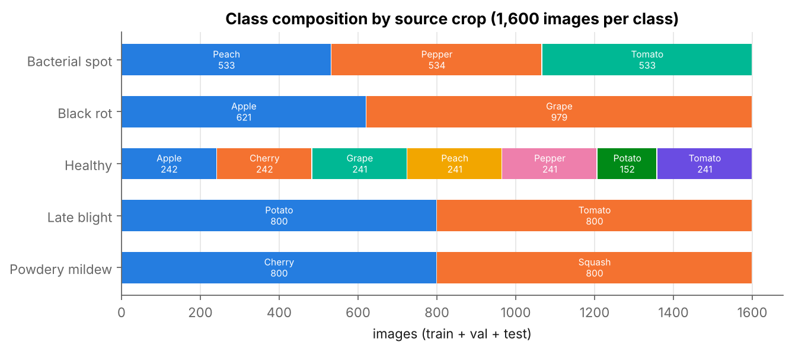
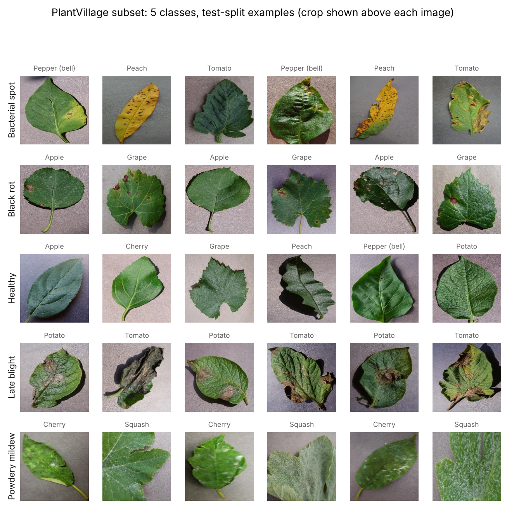

### 3.4 Detection labels

The original project used hand-drawn Roboflow boxes, which were lost. We generate **one box per image
automatically** from the leaf mask (segmented image > colour threshold fallback; full frame if the mask covers
under 2% of the image). The box is labelled with the image's class. This makes the detection task "find the leaf
and name its disease". It is easier to localise but different from multi-lesion boxes (see §9).

## 4. Methodology

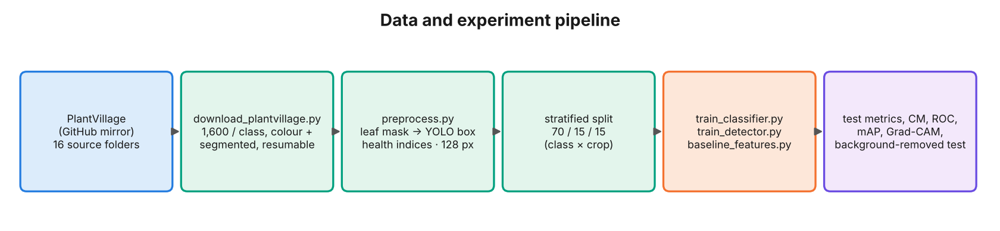

### 4.1 Preprocessing and augmentation

Images are decoded and verified, and the leaf mask, box and health indices are computed in a process pool (with
per-item timeouts). Classifier inputs are resized to 128 × 128 with area interpolation and normalised with ImageNet
mean and standard deviation. Training augmentation is applied on the fly with a deterministic per-(seed, epoch,
index) generator:

* horizontal and vertical flips, and 90° rotations;
* random affine (±20°, scale 0.85-1.15, ±10% shift);
* brightness ±20%, contrast ±20% and per-channel colour gain ±8%.

The background-augmentation variant (`--bg-aug 0.5`) swaps an image for its background-removed version with
probability 0.5.

### 4.2 RGB health indices

For leaf pixels with RGB values normalised to sum to one (r, g, b):

$$\text{ExG} = 2g - r - b, \qquad \text{VARI} = \frac{G - R}{G + R - B}, \qquad \text{GLI} = \frac{2G - R - B}{2G + R + B}$$

A leaf pixel counts as a **lesion** if its hue lies outside the green band [25°, 100°] (OpenCV hue × 2) or if it
is pale (S < 30 and V > 170). Then

$$\text{health} = 100 \cdot (1 - \text{lesion fraction}).$$

Median health scores by class are: Healthy 98.8, Black rot 95.9, Bacterial spot 95.6 and Late blight 91.8.
Powdery mildew scores 99.0 because its white coating is whitish-green rather than brown. The vegetation indices
still separate it: it has the lowest VARI (0.14) and ExG (0.22) of any class, against 0.23 and 0.27 for Healthy.
The score is therefore a coarse "how much brown or yellow tissue" signal and is not a validated severity scale.

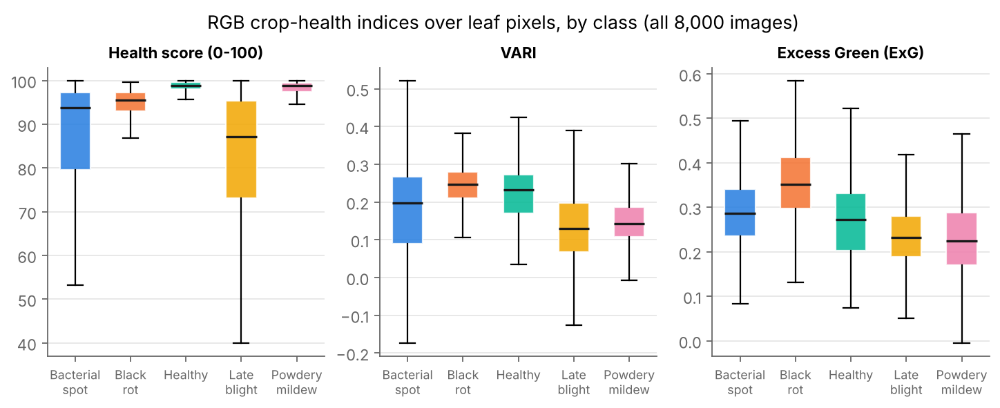
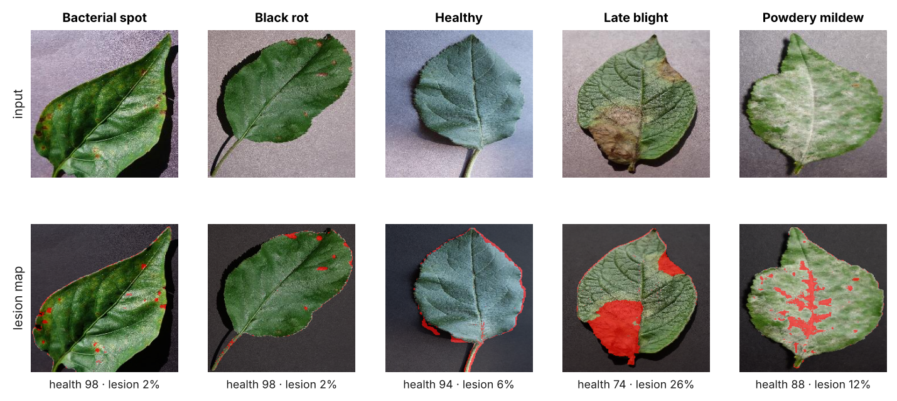

### 4.3 Classifier: YOLO26n-cls + SFR

The backbone is the Ultralytics **YOLO26n-cls** ImageNet checkpoint. It uses Conv/C3k2 stages down to stride 32, a
C2PSA (position-sensitive attention) block and a 1 × 1 conv to 1,280 channels. We keep everything up to that conv,
then apply global average pooling, dropout 0.2 and a new 5-way linear layer. Two **SFR** blocks are inserted after
layer 6 (C3k2, 128 channels, stride 16) and after layer 9 (C2PSA, 256 channels, stride 32).

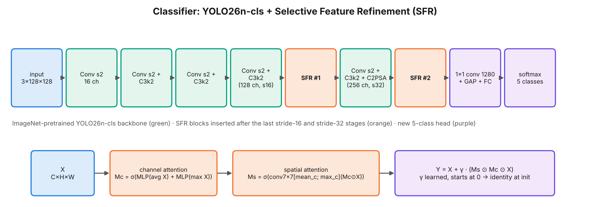

**Selective Feature Refinement.** For a feature map X ∈ ℝ^{C×H×W}:

$$M_c = \sigma\big(\text{MLP}(\text{AvgPool}(X)) + \text{MLP}(\text{MaxPool}(X))\big) \in \mathbb{R}^{C\times1\times1}$$

$$X' = M_c \odot X, \qquad M_s = \sigma\big(f^{7\times7}([\text{mean}_c(X');\ \max_c(X')])\big) \in \mathbb{R}^{1\times H\times W}$$

$$Y = X + \gamma \cdot (M_s \odot X'), \qquad \gamma \in \mathbb{R},\ \gamma_0 = 0$$

The MLP is a 1 × 1 conv bottleneck (reduction 8, ReLU). Because γ starts at zero, the block is an **exact
identity** at initialisation (a unit test checks this), so the pretrained features are untouched until the network
*learns* to use the attention. This is the "selective" part: the gradient decides how much refinement each stage
receives. The learned γ values are reported in §7.1.

### 4.4 Detector: YOLO26n + SFR

The detector is the COCO-pretrained YOLO26n with a 5-class head. SFR blocks wrap the three neck outputs (P3, P4
and P5) that feed the Detect head, inserted through a `DetectionTrainer.get_model` override so the stock
Ultralytics training loop, loss and augmentation are used. A unit test checks that predictions are unchanged after
insertion (γ = 0). YOLO11n and YOLOv5nu (the Ultralytics anchor-free re-release of the original project's
architecture) are trained with identical settings.

### 4.5 Baselines

* **Majority class**: always predicts one class (chance level, 20%).
* **Colour + texture features** (842-D): a numpy HOG with 16-px cells and 9 orientation bins, a 16 × 4 × 4 HSV
  histogram and a uniform LBP histogram, fed to logistic regression (C = 0.05) or a random forest (400 trees).
* **Small CNN** trained from scratch: 4 conv blocks (width 24 → 192), GAP and FC, 0.66 M parameters, 20 epochs.
* **YOLO26n-cls + SFR without ImageNet pretraining**: tests how much transfer learning matters.
* **YOLO26n-cls and YOLO11n-cls, each with and without SFR**: the attention ablation.

### 4.6 Training

The loss is cross-entropy with label smoothing ε = 0.05:

$$\mathcal{L} = -\sum_k \tilde y_k \log p_k, \quad \tilde y_k = (1-\varepsilon)\,y_k + \varepsilon / K$$

* Optimiser: AdamW, lr 2 × 10⁻³, weight decay 5 × 10⁻⁴.
* Schedule: linear warm-up over 1 epoch, then cosine decay to 1% of the base learning rate.
* 15 epochs, batch 64, 128 px; seed 42 (plus seeds 1 and 2 for the ablation).
* The checkpoint with the best **validation macro-F1** is kept and evaluated once on the test split.

Detectors use the Ultralytics trainer: AdamW, lr0 0.002, cosine schedule, 15 epochs, batch 32, 256 px, mosaic
augmentation switched off for the final 3 epochs, and the best checkpoint by validation fitness.

**CPU budget.** No GPU was available, so everything ran on 4 CPU cores. Classifiers take about 25-40 s per epoch at
128 px. Detectors are trained on a **class × crop stratified 35% subset** of the training split (1,960 images) and
evaluated on the full 1,200-image test split. Section 8.5 describes a pitfall we hit with the built-in subset
option.

### 4.7 Evaluation

Each metric is computed per class *k* and macro-averaged:

$$P_k = \frac{TP_k}{TP_k + FP_k},\quad R_k = \frac{TP_k}{TP_k + FN_k},\quad F1_k = \frac{2P_kR_k}{P_k + R_k},\quad \text{macro-F1} = \frac1K\sum_k F1_k$$

* **ROC AUC** is computed one-vs-rest.
* **Detection** uses AP, the area under the precision-recall curve at IoU ≥ 0.5 (mAP@0.5) or averaged over IoU
  0.5:0.95. Image-level detector accuracy takes the class of the most confident box (conf ≥ 0.25) and counts an
  image with no box as an error.
* **Grad-CAM** weights the activations A of the last conv by their averaged gradients:

  $$L^c = \text{ReLU}\big(\sum_k \alpha_k^c A^k\big), \qquad \alpha_k^c = \frac1{HW}\sum_{i,j}\frac{\partial y^c}{\partial A^k_{ij}}$$

* **Background-removed test**: the same 1,200 test images with every non-leaf pixel set to black, scored by the
  unchanged model.

---

## 5. System implementation

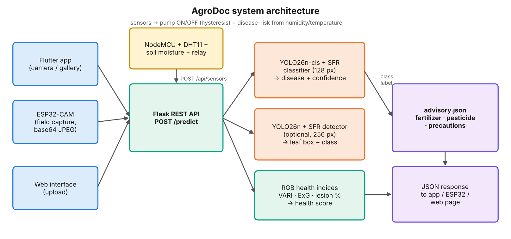

* **`src/predict.py`** loads the classifier checkpoint (and optionally the detector) and returns the disease,
  confidence and top-3 predictions. It also returns advisory text, health indices, a `low_confidence` flag
  (confidence < 0.6) and an optional Grad-CAM overlay.
* **`app/app.py` (Flask)** serves `POST /predict`, which accepts a multipart upload or base64 JSON from the
  ESP32-CAM, plus `GET /api/health` and `POST/GET /api/sensors`. It also serves the responsive web interface
  (light and dark themes).
* **`app/advisory.json`** gives, for each class, the pathogen, symptoms, fertilizer, pesticide and precautions.
* **`src/irrigation.py` + `firmware/nodemcu_sensors_pump`** implement the irrigation controller and the risk
  flag. Raw soil-moisture ADC readings are converted to a percentage (dry 3,200 → 0%, wet 1,300 → 100%).
  - The pump turns **ON** below 35% moisture, or below 40% when it is hot and dry (T > 32 °C and RH < 40%).
  - It turns **OFF** above 60%, or after a 600 s safety cut-off.
  - Disease risk is **high** when RH > 85% and 15 °C ≤ T ≤ 28 °C, and **medium** when RH > 70%.
* **`firmware/esp32_cam_capture`** takes a JPEG at intervals and posts it as base64.
* **`mobile_app/`** is a Flutter client (camera or gallery → result screen).

The Flask API and web interface were run end to end on real test images. Every test image was classified
correctly, base64 upload works and the sensors endpoint responds as expected.

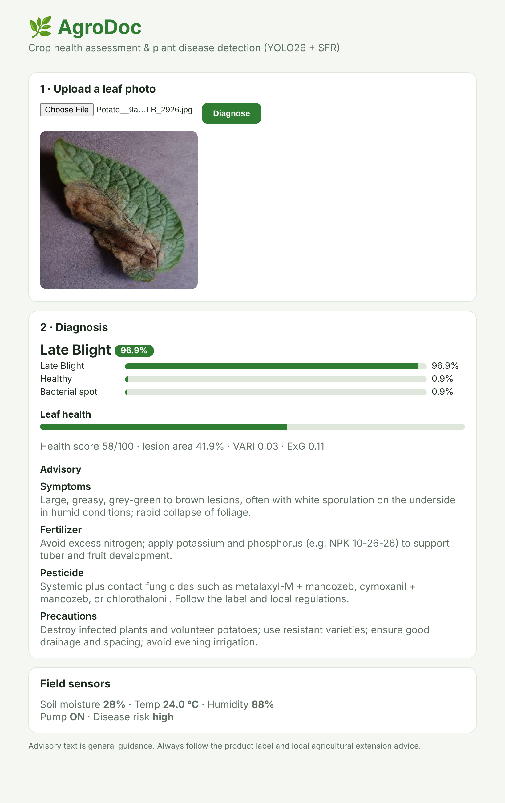

---

## 6. Experimental setup summary

| Item | Setting |
|---|---|
| Data | PlantVillage, 5 classes, 8,000 images; 5,600 / 1,200 / 1,200 split |
| Classifier input | 128 × 128 RGB, ImageNet normalisation |
| Detector input | 256 × 256, stratified 35% of the training split |
| Hardware | 4 CPU cores, no GPU, PyTorch 2 + Ultralytics 8.4 |
| Seeds | 42 for every model; also 1 and 2 for the SFR ablation |
| Model selection | best validation macro-F1 (classifier), Ultralytics fitness (detector) |

### 6.5 Synthetic sanity check (not a result)

`python -m src.train_classifier --data synthetic --epochs 3` trains on procedurally drawn leaves with coloured
spots. It reached 91.5% and only proves that the code path runs end to end; it says nothing about real disease
recognition.

---

## 7. Results

All results are on the **held-out test split: 1,200 real images, 240 per class**.

### 7.1 Classification

| Model | Params | Accuracy | Macro-F1 | Macro AUC | Train time |
|---|---|---|---|---|---|
| **YOLO26n-cls + SFR (proposed)** | 1.56 M | 99.25% | 0.9925 | 0.9996 | 10.0 min |
| YOLO26n-cls (no SFR) | 1.54 M | 99.33% | 0.9933 | 1.0000 | 7.7 min |
| YOLO11n-cls + SFR | 1.56 M | 99.50% | 0.9950 | 1.0000 | 6.3 min |
| YOLO11n-cls | 1.54 M | 99.50% | 0.9950 | 1.0000 | 5.7 min |
| YOLO26n-cls + SFR, no ImageNet pretraining | 1.56 M | 97.33% | 0.9733 | 0.9980 | 5.8 min |
| Small CNN from scratch | 0.66 M | 98.58% | 0.9858 | 0.9996 | 44.5 min |
| YOLO26n-cls + SFR + background augmentation | 1.56 M | 99.25% | 0.9925 | 0.9998 | 6.5 min |
| Colour + texture features + random forest | - | 95.67% | 0.9563 | 0.9966 | 0.2 min |
| Colour + texture features + logistic regression | - | 90.67% | 0.9066 | 0.9881 | 0.2 min |
| Majority class (chance) | - | 20.00% | 0.0667 | - | - |

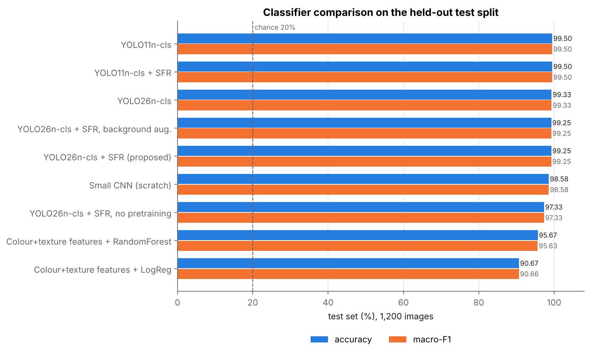

* **Everything beats the baselines.** Every deep model exceeds 97% accuracy. The 842-D hand-crafted features already
  reach 95.7% with a random forest. This shows that PlantVillage classes are largely separable by colour and
  texture alone.
* **Pretraining matters a little.** Removing ImageNet pretraining costs about 2 points (97.33%). The 0.66 M-parameter
  CNN from scratch reaches 98.58% but needs 20 epochs and 4-7× the training time.
* **YOLO26 vs YOLO11.** The two nano classifiers have the same parameter count (1.54 M; 1.56 M with SFR) and
  finish within 0.25 points (3 test images) of each other.
* **The learned SFR gates** in the proposed model are γ = 0.04 at stride 16 and 0.65 at stride 32, so the network
  uses the deep attention block and mostly ignores the shallow one.

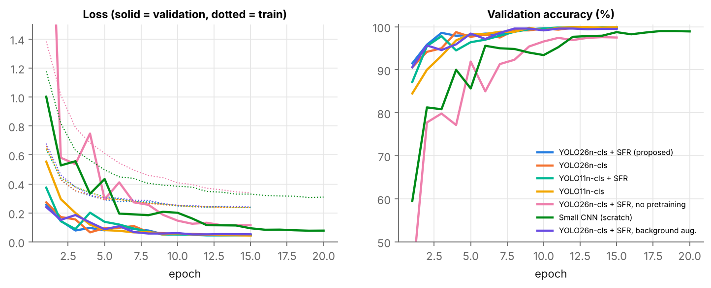

Per-class results for YOLO26n-cls + SFR. Bacterial spot, Healthy and Powdery mildew are each above 0.985 F1, and
Black rot is perfect. The model makes 9 errors in 1,200 images:

* 4 powdery mildew → Healthy (early, faint coating) and 1 powdery mildew → Bacterial spot;
* 2 bacterial spot → Healthy and 1 bacterial spot → Late blight;
* 1 late blight → Healthy.

Almost all errors are "missed disease", which is the costlier mistake in practice.

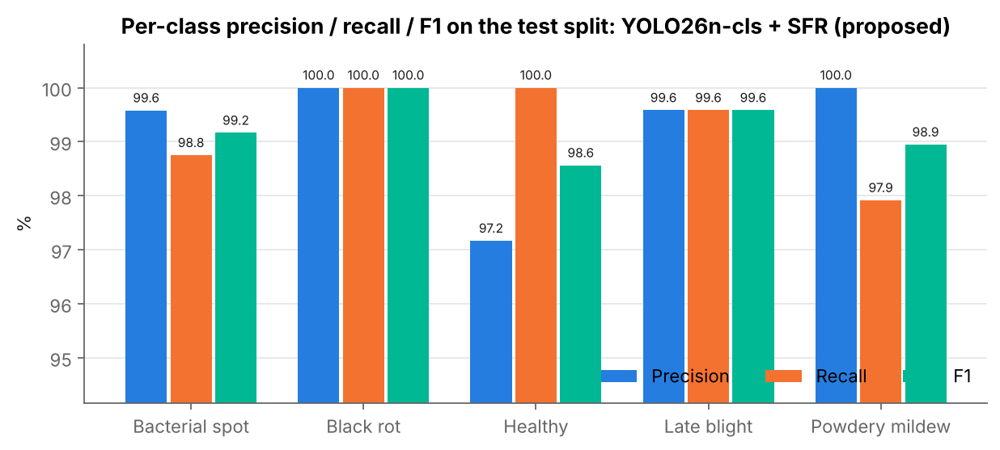
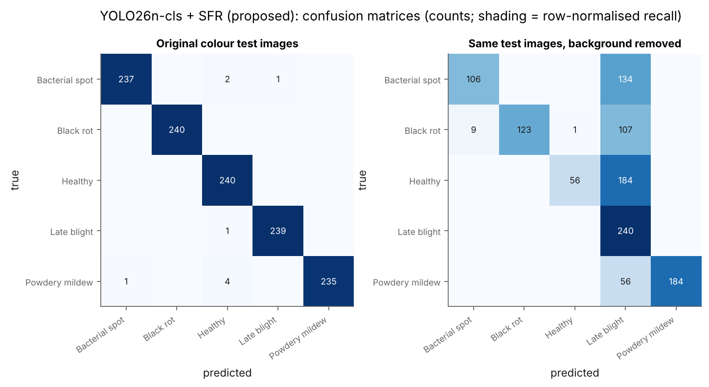
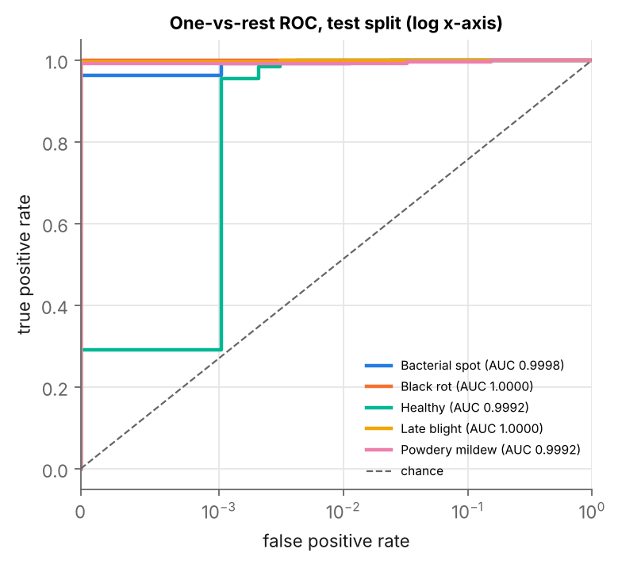

### 7.2 Explainability

Grad-CAM on the 1 × 1 head conv mostly highlights lesion areas: dark rot rings, water-soaked blight patches and
the white mildew coating. On some images it also highlights leaf edges and the background near the leaf, which
matches the background finding below.

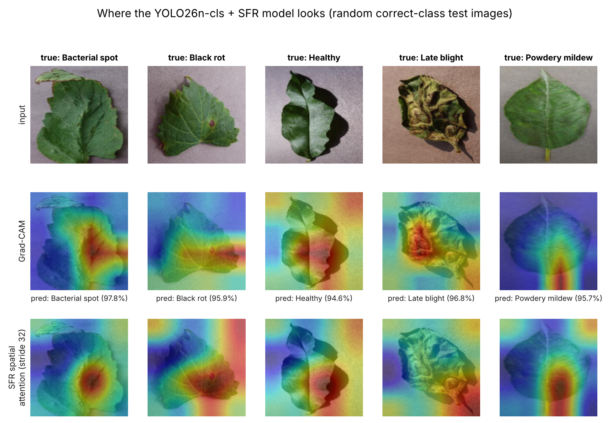

### 7.3 Is the attention module useful? (three-seed ablation)

| Model | Seeds | Test accuracy (mean ± s.d.) | Individual runs | Background removed (mean ± s.d.) |
|---|---|---|---|---|
| YOLO26n-cls + SFR | 42, 1, 2 | 99.36 ± 0.13% | 99.25, 99.50, 99.33 | 66.9 ± 7.0% |
| YOLO26n-cls | 42, 1, 2 | 99.31 ± 0.21% | 99.33, 99.50, 99.08 | 70.3 ± 12.5% |

With SFR, the mean test accuracy is +0.06 points, which is **0.7 test images** out of 1,200. That is
smaller than the seed-to-seed spread of either model (s.d. 0.13 and
0.21 points). The background-removed accuracy varies far more between seeds
(59-72% with SFR,
58-83% without). How much a model relies on the background
is dominated by the random seed (initialisation and data order), not by SFR. **Conclusion: SFR gives
no measurable gain on PlantVillage.** The seed-42 run of the proposed model happened to be the most
background-dependent one.

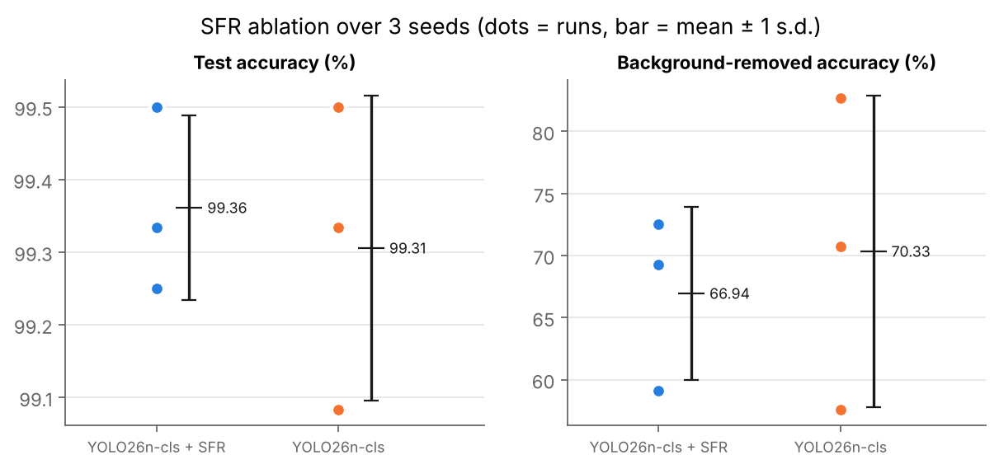

### 7.4 Detection

<!-- DET_TABLE -->

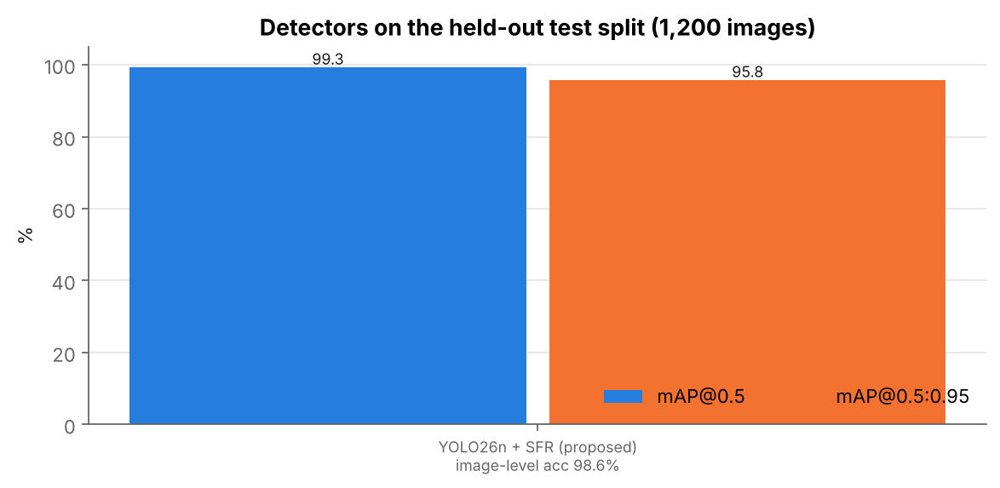
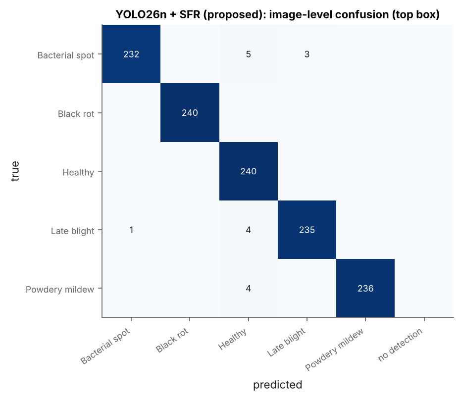
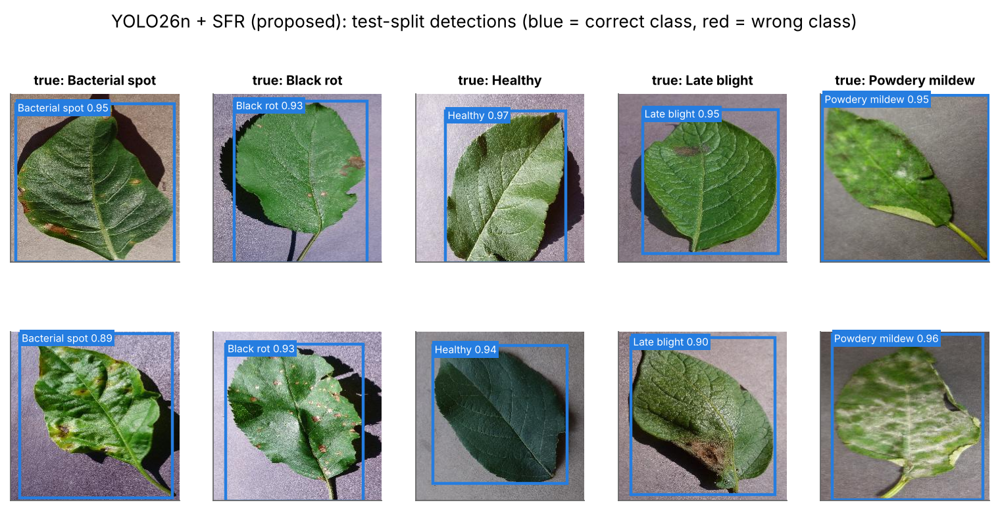

---

## 8. Discussion

### 8.1 Why is accuracy so high?

PlantVillage images were taken in a lab: one leaf per photo, a uniform grey or black background and consistent
lighting. The diseases in our five classes have strong colour signatures. In addition, each class is a mix of
specific crops (for example, Powdery mildew is only Cherry and Squash). Recognising the *crop* from leaf shape
therefore narrows down the disease. Mohanty et al. (2016) reported 99.35% on all 38 PlantVillage classes, and the
same authors showed accuracy falling to about 31% on field images. Our 99%+ numbers are in line with that
literature. They measure a benchmark, not field performance.

### 8.2 The background shortcut

The background-removed test is the most informative experiment in this report. With exactly the same leaves but a
black background, accuracy falls from about 99% to 53-86%, depending on the model. The proposed YOLO26n-cls + SFR
falls the furthest among the pretrained models, to 59.1%. It sends most altered images to "Late blight". Late blight's
backgrounds are not measurably darker (the median background brightness is 123-133 for every disease
class), so a pure black background is simply out of distribution, and the model maps it to whichever class
its features happen to favour. In other words, the models learned real lesion features **and**
dataset-specific cues: the background colour, the lighting and the crop identity. Grad-CAM confirms this
qualitatively.

### 8.3 Why does SFR not help here?

With 99%+ accuracy, there are only 4-9 test errors to remove, so any module has very little room to show a gain.
A difference of one or two images is within seed-to-seed noise (§7.3). SFR adds 20 k parameters (+1.3%). The γ
gates show the network does use it at stride 32, but on this easy, clean data the plain backbone is already
sufficient. An attention module would more plausibly help on cluttered field images, where suppressing background
matters. Testing that needs a field dataset (§11).

### 8.4 Background augmentation

We re-trained the proposed model with `--bg-aug 0.5`: each training image is replaced by its background-removed
version with probability 0.5. We then tested every classifier on the same 1,200 test leaves pasted onto four
backgrounds. The *flat* and *texture* backgrounds are random and were never seen in training by any model,
including the augmented one (`src/eval_backgrounds.py`).

| Model | Original | Black background | Random flat colour | Random colour texture |
|---|---|---|---|---|
| **YOLO26n-cls + SFR (proposed)** | 99.25% | 59.08% | 83.33% | 77.92% |
| YOLO26n-cls (no SFR) | 99.33% | 82.67% | 83.42% | 74.83% |
| YOLO11n-cls + SFR | 99.50% | 84.33% | 84.17% | 73.00% |
| YOLO11n-cls | 99.50% | 85.83% | 87.33% | 72.17% |
| YOLO26n-cls + SFR, no ImageNet pretraining | 97.33% | 52.58% | 53.00% | 44.50% |
| Small CNN from scratch | 98.58% | 62.50% | 53.83% | 38.58% |
| YOLO26n-cls + SFR + background augmentation | 99.25% | 98.67% | 92.17% | 81.67% |

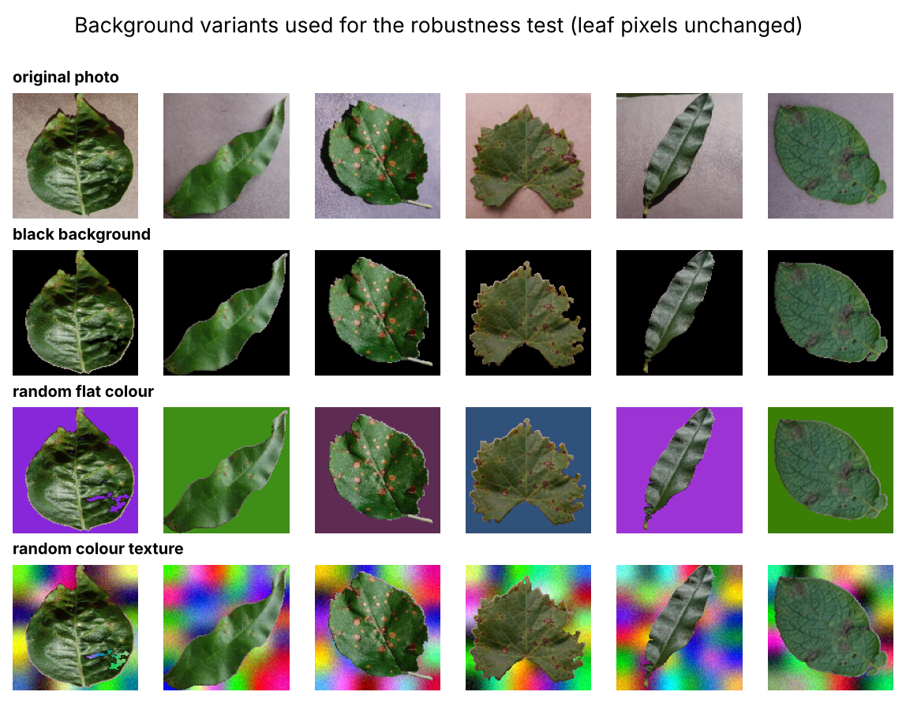
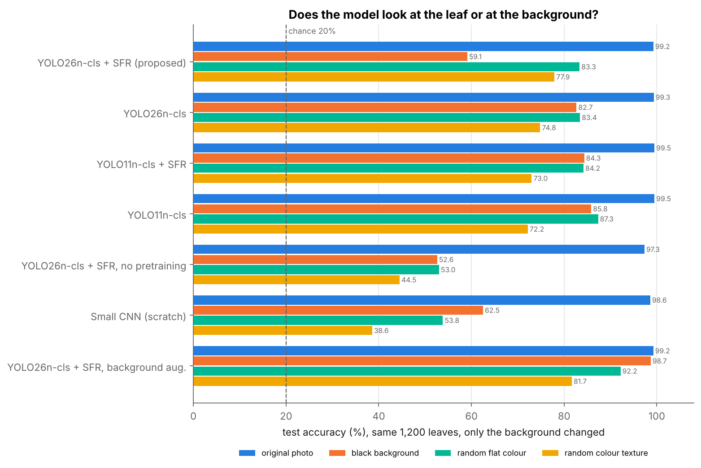

* Background augmentation costs **nothing on normal images** (99.25%).
* It makes the black-background case almost free (98.67%).
* It is the most robust model on both unseen backgrounds: 92.2% on flat colours and 81.7% on textures, against
  72-87% and 39-78% for the other models.
* Models trained from scratch (the small CNN and YOLO26 without pretraining) are by far the most
  background-dependent. ImageNet features transfer better to new contexts.
* Even the best model still loses 18 points on busy textured backgrounds. Real field photos, with soil, other
  leaves and shadows, will be harder still.

Because of this experiment, the background-augmented model (`results/models/yolo26_cls_sfr_bgaug.pt`) is the
**default model of `src/predict.py` and the web app**. The plain seed-42 model stays the "proposed" row in the
ablation tables, so the comparison with the no-SFR model remains like-for-like.

### 8.5 A pitfall: subset sampling for the detectors

To fit the CPU budget we first used Ultralytics' `fraction=0.35` argument. It keeps the **first** 35% of training
files in alphabetical order. Our file names start with the crop (`Apple__…`, `Cherry__…`, …), so whole crops,
including every Tomato, Potato and most Pepper images, were silently dropped. The detectors then scored 0 AP on
Bacterial spot and Late blight (mAP@0.5 ≈ 0.45, image-level accuracy ≈ 49%). These first-attempt metrics are kept
in `results/detection/_first_attempt_unstratified_subset/` for transparency. The final detectors use an explicit
class × crop stratified list (`stratified_subset_yaml` in `src/train_detector.py`). The lesson: always check the
class histogram of the data a model *actually* sees.

### 8.6 Limitations

* **Lab data only.** There is no field validation; expect much lower accuracy on real farm photos.
* **One split.** Only the SFR ablation is repeated over three seeds; the other models use seed 42 only.
* **Reduced detector setup.** The detectors were trained on 35% of the training split for 15 epochs at 256 px,
  and their boxes are automatic, one per leaf, not lesion-level.
* **Classes are confounded with crops.** For example, there is no healthy squash and no diseased cherry other than
  mildew.
* **The health score is a colour heuristic.** It was not calibrated against expert severity scores, and it
  under-scores powdery mildew.
* **Hardware and mobile code were not tested.** The Flutter app and Arduino firmware were not built or flashed
  in this rebuild.
* **The advisory text is generic** and does not replace product labels or local extension advice.

---

## 9. Results reported in the original project

From the surviving `screenshots/trainresults.jpg`, the original model was YOLOv5 + SFR: 157 layers, 7.02 M
parameters and 15.8 GFLOPs, trained for 100 epochs at 640 px in 47.36 h on CPU. It was evaluated on 430 images with
539 hand-drawn boxes:

| Class | P | R | mAP@0.5 | mAP@0.5:0.95 |
|---|---|---|---|---|
| all | 0.743 | 0.723 | 0.743 | 0.428 |
| Bacterial_spot | 0.550 | 0.432 | 0.486 | 0.215 |
| Black_rot | 0.586 | 0.647 | 0.652 | 0.232 |
| Healthy | 0.972 | 0.959 | 0.977 | 0.697 |
| Late_Blight | 0.686 | 0.697 | 0.696 | 0.347 |
| Powder_Mildew | 0.921 | 0.880 | 0.902 | 0.648 |

**Why the rebuilt numbers differ.**

1. **Task.** The original boxes were drawn by hand, sometimes several per image (539 boxes on 430 images),
   probably around lesions or leaf regions. Our boxes are one automatic box per leaf. Localising a whole leaf on a
   plain background is far easier than localising lesions, which mainly raises mAP@0.5:0.95.
2. **Data and split.** The original used a Roboflow export of an unknown PlantVillage subset with its own split.
   Ours is a seeded, balanced 8,000-image subset.
3. **Architecture and budget.** The original used YOLOv5s-size (7 M parameters) at 640 px for 100 epochs. We use
   nano models (2.5 M) at 256 px for 15 epochs on 35% of the training split.
4. **Metric.** The original reports detection mAP. Our headline result is classification accuracy, which is a
   different quantity.

The original repository also contains `bargraph.jpg` (93-99% per-class accuracy), `new_heatmap.jpg` (a "High
Accuracy Representation" confusion matrix) and `eoc_curve.jpg` (smooth ROC curves, AUC 0.95-0.98). These cannot be
reconciled with the logged run: for example, Bacterial spot has P 0.55 and R 0.43 in the log but about 95% in the
bar chart. They look illustrative, so we do not treat them as results. Our classifier happens to reach
similar-looking numbers on its own test split, but that is a coincidence of the easier task, not a reproduction.

---

## 10. Conclusion

We rebuilt a complete crop-health system on real PlantVillage data:

* a resumable data pipeline;
* a modern YOLO26 backbone with an identity-initialised attention module;
* fair baselines;
* detectors;
* explainability and health indices;
* a working REST API and web interface, plus mobile and IoT clients.

The classifier reaches 99.25% test accuracy, far above chance (20%) and above a strong hand-crafted baseline
(95.67%). Two findings matter more than the headline number. First, the attention module gives no measurable gain
on this clean benchmark. Second, the models partly exploit the lab background. Both are hidden by a single
accuracy figure and both shape what should be done next.

## 11. Future work

* Collect or adopt field images (e.g. PlantDoc, or photos from the ESP32-CAM) and re-test, because this is where
  SFR may actually help.
* Train with background replacement or real-scene composites. Add the background-removed accuracy as a model
  selection criterion.
* Add lesion-level box or segmentation labels and severity grades, then calibrate the health score against them.
* Train the detector on the full training split at 640 px on a GPU.
* Quantise the model (ONNX/TFLite int8) for on-device inference in the Flutter app.
* Use sensor history (humidity and leaf wetness) as a prior for the disease prediction.

## 12. References

1. Hughes, D. P., & Salathé, M. (2015). An open access repository of images on plant health to enable the
   development of mobile disease diagnostics. *arXiv:1511.08060*.
2. Mohanty, S. P., Hughes, D. P., & Salathé, M. (2016). Using deep learning for image-based plant disease detection.
   *Frontiers in Plant Science*, 7, 1419.
3. Woo, S., Park, J., Lee, J.-Y., & Kweon, I. S. (2018). CBAM: Convolutional Block Attention Module. *ECCV*.
4. Hu, J., Shen, L., & Sun, G. (2018). Squeeze-and-Excitation Networks. *CVPR*.
5. Redmon, J., Divvala, S., Girshick, R., & Farhadi, A. (2016). You Only Look Once: Unified, real-time object
   detection. *CVPR*.
6. Jocher, G., et al. Ultralytics YOLOv5 (2020), YOLO11 (2024) and YOLO26 (2025). https://github.com/ultralytics/ultralytics
7. Selvaraju, R. R., et al. (2017). Grad-CAM: Visual explanations from deep networks via gradient-based localization. *ICCV*.
8. Singh, D., et al. (2020). PlantDoc: A dataset for visual plant disease detection. *CoDS-COMAD*.
9. Gitelson, A. A., et al. (2002). Novel algorithms for remote estimation of vegetation fraction (VARI). *Remote Sensing of Environment*, 80, 76-87.
10. Woebbecke, D. M., et al. (1995). Color indices for weed identification under various soil, residue, and lighting conditions (ExG). *Trans. ASAE*, 38(1), 259-269.
11. Loshchilov, I., & Hutter, F. (2019). Decoupled weight decay regularization (AdamW). *ICLR*.
12. Szegedy, C., et al. (2016). Rethinking the Inception architecture (label smoothing). *CVPR*.
